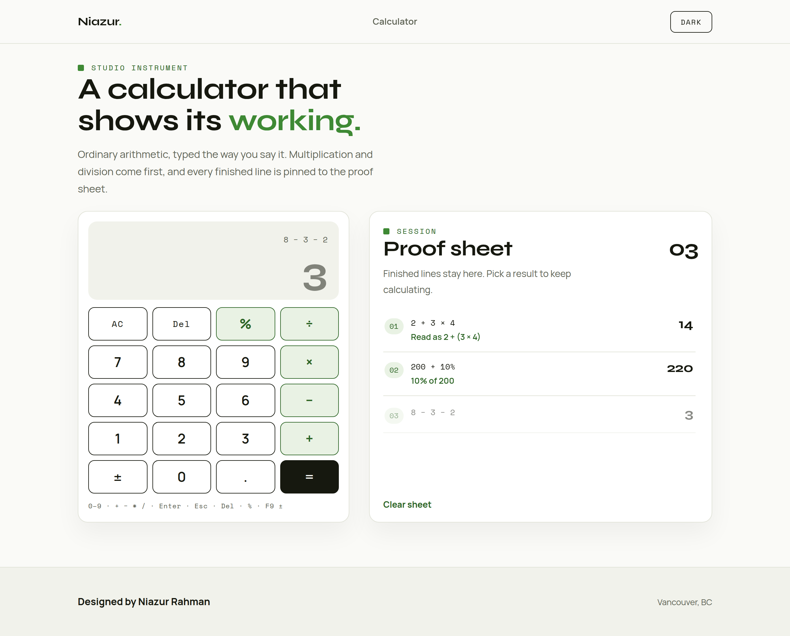
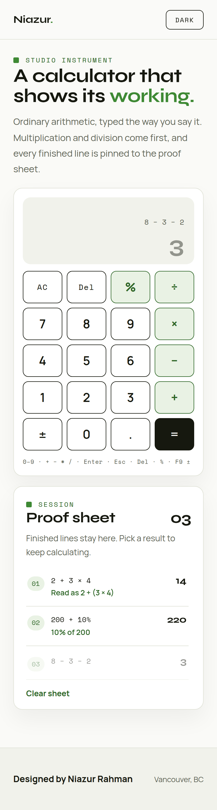
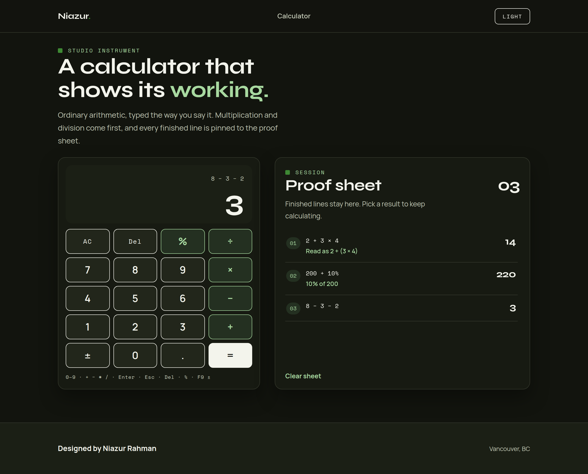

# Calculator

A small calculator for ordinary arithmetic, set in the same type and colour as [Niazur Rahman](https://www.niazur.me)'s studio site. It is a public showcase: one instrument, with the working left on the page.

**Live:** https://niaz507.github.io/calculator/





Night theme, from the same ink:



## The idea

The portfolio is warm paper, deep ink, and a forest green. Headlines are Syne, body and keys are Manrope, and the small labels are Space Mono. This calculator uses that system rather than inventing a second one.

The part meant to be remembered is the **proof sheet**. Every line you finish is pinned beside the keys. When multiplication or division would change a left-to-right reading, the sheet says how the line was actually read (`2 + 3 × 4` is `2 + (3 × 4)`). Percent is written the same way: `200 + 10%` notes `10% of 200`. A result on the sheet can be picked up and used again.

[Designed by Niazur Rahman](https://www.niazur.me)

## What it does

- Addition, subtraction, multiplication, and division, with multiplication and division first, and ties resolved left to right
- Decimals, percent, sign, backspace, and all clear
- A live result while a line is still being typed
- Divide by zero and numbers that are too long are named in the display. Backspace returns you to the line so it can be edited
- Thousands separators on long figures, then exponential form past twelve digits
- Equals again repeats the last operation (`2 + 3 = =` continues by threes)
- Keyboard, as well as the keys
- Light and dark. The first visit follows the system. The choice is remembered
- Visible focus, named buttons, a skip link, and `prefers-reduced-motion`

## Keyboard

| Key | Action |
| --- | --- |
| `0–9` | Digits |
| `.` or `,` | Decimal point |
| `+` `−` `*` `/` and `x` | Operators |
| `Enter` or `=` | Equals |
| `Escape` or `Delete` | All clear |
| `Backspace` | Delete the last entry |
| `%` | Percent |
| `F9` or `_` | Toggle sign |

## Design tokens

Taken from [`styles.css` on niazur.me](https://www.niazur.me/styles.css) in November 2026.

| Token | Value | Use |
| --- | --- | --- |
| `--bg` | `#FAFAF7` | Page, a warm paper |
| `--surface` | `#F1F2EB` | Display well, footer |
| `--ink` | `#16180F` | Text, key borders, the equals key |
| `--muted` | `#5C6153` | Secondary copy |
| `--green` | `#3E8934` | The square mark, the accent word, focus |
| `--green-ink` | `#2C6425` | Green text and operator borders |
| `--green-soft` | `#E9F2E4` | Operator keys, index pills |
| `--line` | `#E1E3D8` | Hairline borders |
| `--danger` | `#B3261E` | Errors. This red is already used on the portfolio |

Type: **Syne** (600, 700) for the headline and the figures, **Manrope** (400–700) for body and keys, **Space Mono** for labels, the expression, and the keyboard hint. Loaded from Google Fonts, the same families as the portfolio.

Space and shape, also from the site: page padding `clamp(24px, 5.5vw, 56px)`, a 70px header, radii of 8, 10, 14, and 16px, and pills at 999px. Colour and background move in 0.2s, press in 0.15s. Focus is a 2px green outline, 2px outside the control. `prefers-reduced-motion` collapses animation and transition time, as the portfolio does.

A few contrast adjustments stay inside the same palette:

- Small green text uses `--green-ink` (`#2C6425`), not `--green`. On the paper, `#3E8934` is about 4.2:1, which is fine for the large accent word and short of 4.5:1 for small type.
- Selection is `#2C6425` with white, for the same reason.
- The dark theme turns `--ink` into the night ground (`#12140E`) and lifts green text to `#A8D9A0` so it stays readable. Error text at night is `#FFB4AB`.

## Run it

`index.html` is at the repository root. Open that file, or serve the folder. There is no build step, which is what GitHub Pages needs:

```bash
python3 -m http.server
```

The live link above works once GitHub Pages is set to deploy from the `main` branch, root directory.

## Tests

The arithmetic lives in `calc.js`, with no DOM, so the page and the tests share it.

```bash
node test/eval.test.js
```

`npm test` runs the same script.

## License

[MIT](LICENSE). Copyright 2026 Niazur Rahman.
